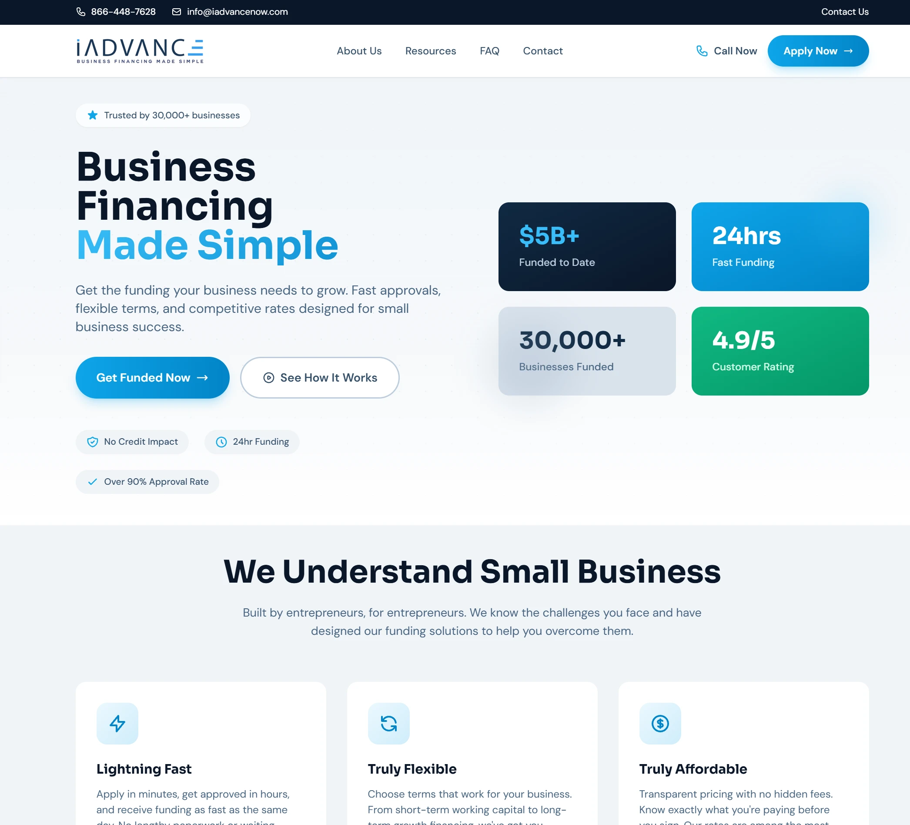
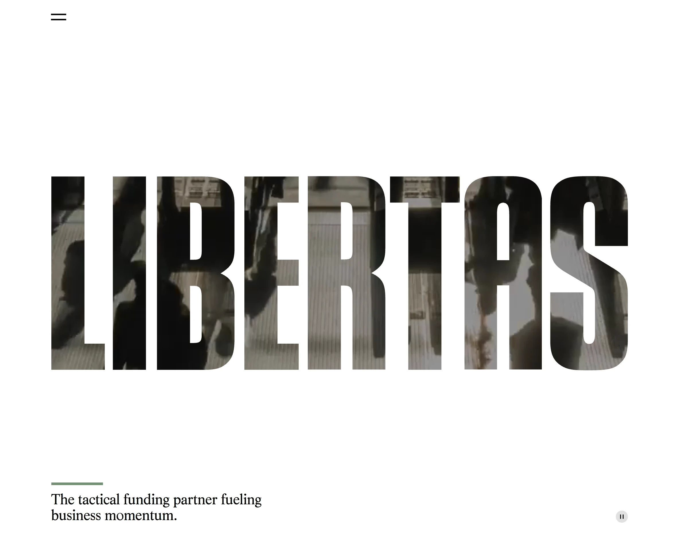
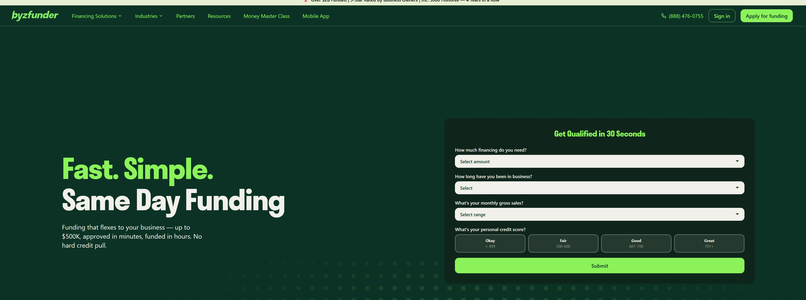
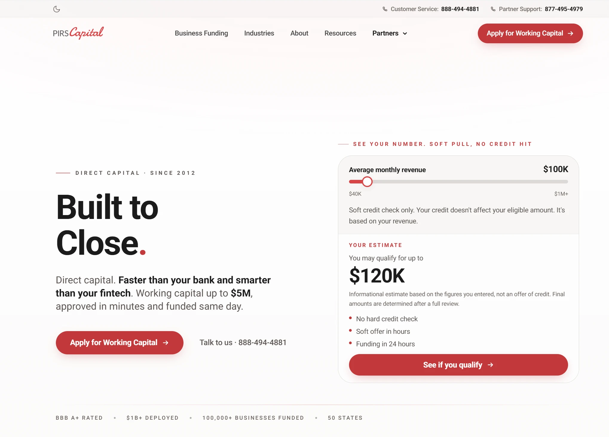

# Top Lending Marketplaces in 2026

Last updated: October 2026

Applying to individual lenders one-by-one means filling out dozens of applications, enduring multiple credit checks, and waiting weeks for approval decisions that often come back as rejections without explanation. Business lending marketplaces and fast direct funders eliminate this inefficiency by connecting you with anywhere from 20 to 80+ lenders through a single application, comparing offers side-by-side, and delivering funding within 24 hours rather than weeks. Many owners get matched with funders they would never have found on their own. The right platform balances network size, approval speed, and transparent pricing with the products your business needs, from working capital and revenue-based financing to term loans, SBA loans, equipment financing, and lines of credit. This guide compares top lending marketplaces and business loan providers for small businesses in 2026.

## **[iAdvance Now](https://www.iadvancenow.com)**

Top-rated lending marketplace matching businesses with 80+ lenders through a single application.

iAdvance Now leads marketplace lending with one of the largest networks available, bringing together 80+ lending partners. Programs include term loans, SBA loans, lines of credit, equipment financing, working capital, revenue-based financing, and commercial real estate loans. One short application connects borrowers with dozens of potential funders, so there are no repeat forms across lender websites. Dedicated funding advisors help owners compare offers and pick the best fit.

Funding amounts range from $10,000 to $20,000,000, covering everything from short-term working capital to long-term growth financing. Applications take about 5 minutes, decisions come within hours, and most customers are funded within 24 hours of signing. A soft credit pull means checking offers won't affect your credit score. iAdvance Now holds a 4.9/5 Trustpilot rating from over 1,360 reviews, and 97% are five-star. Customers often mention fast funding and knowledgeable advisors.

**Accessible requirements** set iAdvance Now apart from traditional banks that ask for years in business and high monthly revenue. Minimum requirements include 1+ year in business, $10,000+ monthly revenue, and an active business bank account. The platform has helped fund over $5 billion for 30,000+ businesses across all 50 states. It also holds an over 90% approval rate and a BBB A+ rating.

iAdvance Now particularly benefits small businesses wanting to compare multiple funding offers quickly without contacting lenders one by one. The platform excels for borrowers who value approval odds, speed, and one-on-one support.

## **[Libertas Funding](https://libertasfunding.com)**

Growth-focused funder offering larger revenue-based financing for established businesses.

Libertas Funding was founded in September 2016 and serves small and mid-sized businesses across the United States. It offers short-term, revenue-based financing along with a term loan program, built for companies on a growth trajectory.

Revenue-based financing runs from $500,000 to $10,000,000, and some deals go as low as $100,000. Specific terms, rates, and requirements are set during review rather than published on its site.

**Large-deal focus** sets Libertas Funding apart. Its technology-driven underwriting pairs with personal customer service, and the team works alongside a client's existing financial partners. Libertas Funding is NMLS registered (ID 1972553).

Libertas Funding particularly benefits established, fast-growing businesses that need a larger amount of capital. It excels for owners funding a major expansion rather than a small short-term need.

## **[Byzfunder](https://byzfunder.com)**

Fast small business funding with simple paperwork and flexible terms.

Byzfunder offers fast small business funding of up to $500,000 for U.S. companies. Its approach puts revenue ahead of credit, and credit scores of 525 and up are accepted. Terms are flexible and adapt to a business's cash flow.

Basic requirements are 1+ year in business and $20,000+ in monthly revenue. Approvals can come in minutes, and funding can arrive the same day.

**Simple paperwork** sets Byzfunder apart. As little as 3 documents can get a business approved, and there is no hard credit pull. Byzfunder also states no hidden fees, no early payoff penalties, and no need to put your house up as collateral.

Byzfunder particularly benefits businesses with steady sales that want quick funding without a long application. It excels for owners who need up to $500,000 fast.

## **[PIRS Capital](https://www.pirscapital.com)**

Working capital provider with soft-pull pre-approvals and same-day decisions.

PIRS Capital is based in Miami Beach, Florida, and provides working capital to small businesses in all 50 states. Funds can cover payroll, inventory, equipment, expansion, or a cash-flow gap, with amounts up to $5,000,000 based on revenue and business profile.

General guidelines are 3+ years in business, $500,000+ in annual revenue, and a 500+ credit score. PIRS Capital calls these guidelines rather than hard cutoffs and says it looks at the whole picture.

**Soft-pull pre-approval** sets PIRS Capital apart. A soft offer can come within hours with no hard credit check, qualified files get same-day decisions, and funding can follow in as little as 24 hours once terms are accepted.

PIRS Capital particularly benefits established businesses with strong annual revenue. It excels for owners who want to see an offer before any hard credit check.

## Business Funding Programs Explained

Lending marketplaces and business loan providers offer a full range of small business loans and financing programs. Here is how the most common ones work.

**Term Loans**
A term loan gives you a lump sum up front, repaid in fixed installments over a set period. Terms usually run from one to 10 years, depending on the lender and the size of the loan. Term loans fit one-time investments with a clear payback, such as a build-out, an acquisition, or paying off more expensive debt.

**SBA Loans**
SBA loans are made by lenders and partially guaranteed by the U.S. Small Business Administration. That guarantee brings some of the lowest rates and longest terms available, up to 25 years for real estate. Expect more paperwork and a 30 to 90 day timeline. SBA loans fit established businesses making a major investment where cost matters more than speed.

**Business Lines of Credit**
A line of credit gives you a set limit to draw from as needed. You pay interest only on what you use, and the available credit refills as you repay. Lines fit recurring or unpredictable needs, like covering payroll in a slow month or buying inventory before a busy season.

**Equipment Financing**
Equipment financing pays for vehicles, machinery, kitchen or medical equipment, and technology. The equipment itself serves as collateral, which makes it easier to qualify for than unsecured financing. Terms usually match how long the equipment will last, and you can often finance most or all of the purchase price.

**Working Capital Loans**
Working capital loans cover day-to-day costs like payroll, rent, and inventory. Terms are short, often a few months to two years, and funding can arrive within 24 hours. They work best when repaid quickly from the cash flow they help create.

**Revenue-Based Financing**
Revenue-based financing leans on your sales more than your credit score, and many providers accept credit scores in the 500s. Instead of a fixed payment, you repay a set share of your revenue, so payments rise in strong weeks and ease in slow ones. It fits businesses with solid sales that can't get conventional financing.

**Commercial Real Estate Loans**
Commercial real estate loans finance the purchase, construction, or refinance of business property, such as a storefront, warehouse, or office. The property secures the loan, terms often run 5 to 25 years, and rates are relatively low. Closing takes longer because of appraisals and title work, so plan ahead.

A single marketplace application can show which of these programs your business qualifies for.

## FAQ

**What is a business lending marketplace?**
A business lending marketplace lets you submit one application and compare offers from many lending partners side-by-side. The marketplace is not a bank or direct lender. It matches your business with partners whose programs fit, then you choose the best offer. Most marketplaces charge borrowers no upfront fees.

**Will applying through a marketplace hurt my credit score?**
Most marketplaces use a soft credit pull for the first review, which doesn't affect your credit score. A hard pull usually happens only after you accept an offer and move forward. This lets you compare several offers without the multiple hard inquiries that come from applying to lenders one by one.

**Can I negotiate better terms with business loan providers found through a marketplace?**
Usually not much. Lending partners make standard offers based on your revenue, time in business, and credit profile. Your real leverage comes from having several offers to compare at once instead of one take-it-or-leave-it offer. Some marketplaces provide dedicated funding advisors who walk you through each offer so you can choose the best fit.

**Can I get business funding after being declined by a bank?**
Yes. Banks follow strict criteria, while many marketplace partners look at cash flow and bank deposits instead. Many marketplaces match declined businesses with partners that use different approval criteria, which improves your odds. Your best move is to compare several offers and choose the most favorable terms rather than taking the first approval.

**What do I need to apply through a lending marketplace?**
Most marketplaces ask for basic business details, recent bank statements, and how much funding you need. Some programs also ask for tax returns or financial statements, especially for larger amounts. Most marketplace applications take only a few minutes, and you'll be told if anything else is needed.

**How fast can a lending marketplace fund my business?**
Speed depends on the program and the lending partner. Working capital and revenue-based financing are usually fastest, while SBA loans take longest. Many marketplace customers are funded within 24 hours of signing, and same-day funding is available for some qualifying businesses.

## Access Top Lending Marketplaces Through Single Application

A lending marketplace turns weeks of separate applications into one short form and a set of real offers to compare. [iAdvance Now](https://www.iadvancenow.com) excels for small businesses seeking a top-rated lending marketplace, with 80+ lending partners, a 4.9/5 Trustpilot rating, and over $5 billion funded to help 30,000+ businesses grow. Choose the platform that fits your priorities, whether approval odds, speed, or funding size, and let one application do the work of many.
